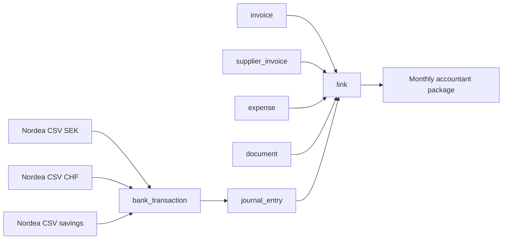

# Excel tracking file → v3 model

Version 2 · 2026-10-20 · Companion to `feature-inventory.md`

The accountant Excel is the de-facto spec: three sheets = journal + invoices + expenses, with the links between them held by hand in the "Related Document" and "Filename" columns. v3 stores the same facts in tables, derives every status, and generates the monthly accountant package from them. The Excel itself retires (D13).



---

## Sheet 1 — Bank Statement

Source: three Nordea CSVs (SEK main, CHF main, savings), consolidated into one sheet with a Currency column.

| Excel column | Filled by | v3 |
|---|---|---|
| Booking date, Amount, Sender, Recipient, Name, Additional details, Message, Own notes, Balance, Currency | CSV | `bank_transaction` — raw, immutable, provenance = account + file + row hash (dedup) |
| Column1 (`date-counterparty`) | you | derived `counterparty_key` — the input for learned categorisation / matching rules |
| Account | you | `bank_account` FK — one per CSV; currency lives on the account |
| Change (rate) | you | `journal_entry.rate` + `rate_source` ∈ {ECB of the day, bank implicit, manual} |
| Amount Base Currency | you | `journal_entry.amount_base` (SEK) — computed once, immutable |
| Related Document (`Ex233-Tr-02_2026-06-02_`, `InvoiceAF_XYY6-002.pdf`) | you | `link` rows: transaction → document / invoice / supplier invoice / expense, with allocated amount |
| Reason | you | `journal_entry.note` |
| Green fill | you | derived: linked / awaiting document / no document needed |
| Grey italic `AVGIFTER NORDEA` | you | BAS category *bank fees*, flag `no_document_needed` |
| Grey italic `CHANGE CHFSEK` (−20 000.00 CHF ↔ +237 740.00 SEK, the owner's anonymised July 2026 example) | you | link kind `transfer` between two own-account transactions; the pair carries the bank implicit rate (237 740 ÷ 20 000 = 11.887); no document needed. Nordea's wording: `Additional details` = `CHANGE CHFSEK <ref>`, `Message` = `CHANGE CHFSEK` (D25) |
| Yellow `SALARY`, `SKATTEVERKET` | you | BAS categories salary / social charges + tax; recurring manual-entry templates |

Observations
- CHF-account rows get an SEK base amount with a rate per row — v3 does this automatically (ECB rate of the booking date) and shows the bank implicit rate next to it when a transfer pair exists.
- Transfer pairs are the one case where two transactions justify each other. Own link kind; rule: both sides linked, neither needs a document.
- The savings account is imported like the others (full picture); it only ever carries capital and yearly interest.

---

## Sheet 2 — Income (client invoices)

| Excel column | v3 |
|---|---|
| Number `VA26-INV-001` | `invoice.number`; series key = `{client short}{yy}-INV`; gap-free per series (`number_series` table) |
| Client / Client Short | `partner` + `partner.short_code` |
| Invoice Date / Due Date | invoice fields; due date defaults from `contract.payment_terms` |
| Activity (`Consulting Services`) | line description, default from contract |
| Note (`2026 January`) | `invoice.period_label` |
| Invoice Currency | from contract (CHF for the Swiss client, EUR or SEK for others) |
| Quantity / Unit (`20 days`) | line: quantity × unit × rate; rate = `contract_rate` valid for the period, stored on the line immutably |
| Tax Excluded / VAT % / VAT / Total | computed, stored as Decimal |
| Pay / Paid Amount / Delta | derived from links to bank transactions (sum of allocations); delta → tolerance rule for bank fees / short payments |
| Status (`Open`) | lifecycle draft → issued → sent → paid / credited; "sent" is set by hand (no email from the app) |
| Comment | `invoice.internal_note` |
| Filename (`InvoiceAF_XX26-001.pdf`) | the PDF generated at issue and stored as a `document`; business key = filename; downloadable any time |
| VAT Declaration (`CH 2026/Q2`) | `vat_registration` (CH) + declaration period derived from invoice date — the Swiss VAT return filter |
| Due VAT % / Due VAT / Delta VAT | derived from the CH VAT registration rate schedule |
| SE Taxes / Z Salary / Ce que AF se fait | owner cash planning — not accounting; owner-only dashboard widget, Growth phase (D14) |

Extra fields the invoice carries: PO number (per invoice), supplier number and 2–3 labelled identifiers (per partner / per contract, already in the v2 model), optional discount, logo, language en/fr/sv.

---

## Sheet 3 — Expenses

In the Excel this sheet mixes four things: company-card purchases, private purchases to reclaim, supplier invoices (`Accounting fees — Factura 9160`) and Swiss VAT payments. v3 separates **supplier invoices into their own module** (payables, D8) and keeps the rest as expenses with groups.

| Excel column | v3 |
|---|---|
| Group / Group Desc (`213 — Travel to CH in March 2026`, `217 — Online subscription`) | `expense_group`: id, description, kind ∈ {trip, batch}; every expense belongs to one; late receipts can join an old group |
| Reason (`Flight`, `Uber`, `Meal Allowance`) | `expense.description` |
| Account Name (`Travel Expense`, `Representation fees`, `Office rent`, `Licences, Cloud and Utilities`, `Accounting fees`, `Events, Conferences and Trainings`, `Swiss VAT`) | BAS category; the alias (`Tr`, `Rep`, `Off`, `Ut`, `Acc`, `Evnt`, `Vat`) is the BAS short code already in v2 |
| Ref (`Ex213-Tr-01`) | display key = `Ex{group}-{alias}-{seq}` — a fixed function, not a configurable pattern |
| Record date | document date |
| Origin Currency / Origin Cost | `expense.amount`, `currency` |
| Exchange Rate / Cost Base | rate + SEK base: bank implicit when paid from an AF account (through the link), ECB of the day when paid privately |
| Paid by (`AF SEK`, `Zikrija Private SE`, `Zikrija Private CH`) | `payment_source`: a bank account (→ link to its transaction) or a private instrument (→ owner liability ledger) |
| Status (`Paid`, `To Refund`, `Refunded`) | derived: company-paid and linked = paid; private and open on the ledger = to refund; private and allocated in a settlement = refunded |
| Refunded / AF Booking Date | booking date of the linked bank transaction |
| Filename Prefix Saved / Proposition (`Ex213-Tr-01_2026-03-11_`) | the document's business key = `{Ref}_{date}_` — generated at upload, used as the stored filename |
| Uploaded Accounting | derived: included in the accountant package of month X |
| Comment (`lunch(s) = 18`, `Ticket is missing…`) | `expense.note` + flag `document_missing` |
| Folder | gone — the package builder decides folders |
| Travel Details (Date/Time From, Date/Time To, Quantity 19.5, Agency) | `trip` on the expense group: departure and return timestamps, country; days computed with the Skatteverket half-day rule (departure after 12:00 / return before 19:00) |
| Meal Allowance row | expense of type `per_diem`: days × normalbelopp (country, year) − meals you enter as paid separately (client lunches) |

Reimbursement (not a column today, done by hand): private expenses accumulate on an **owner liability ledger** in SEK base; a refund bank transaction is linked as a **settlement** with allocations against chosen expenses (FIFO proposed, manual override); partial and cross-currency settlements are allowed and the residual stays open; each settlement generates a reimbursement statement PDF — the justification the refund transaction never had. See `feature-inventory.md` §3.7.

Observations
- The group is first-class: a trip is a group with travel details; a month of subscriptions is a group without them.
- The business-key convention you apply by hand (`Ex213-Tr-01_2026-03-11_`) is exactly what v2 automated — v3 keeps the generation as one fixed function fed by group, BAS alias and date; the configurable prefix engine goes.

---

## What the accountant package becomes

Monthly (D13):

```
2026-06/
  bank-statements/        SEK.csv  CHF.csv  (savings.csv once a year)
  client-invoices/        InvoiceAF_VA26-00x.pdf
  supplier-invoices/      Ex2xx-Acc-01_date_.pdf …
  expenses/               Ex2xx-…_date_.pdf  (receipts, reimbursement statements, Swiss VAT payment proofs)
  summary.xlsx            bank lines → linked artefact · invoices · expenses · manual entries — generated
  notes.md                flags, missing documents, transfer pairs, open owner liability
```

Everything in `summary.xlsx` is a read model over `bank_transaction`, `journal_entry`, `invoice`, `supplier_invoice`, `expense`, `document` and `link`. The accountant gets the same picture as today; nobody maintains a spreadsheet to produce it.
