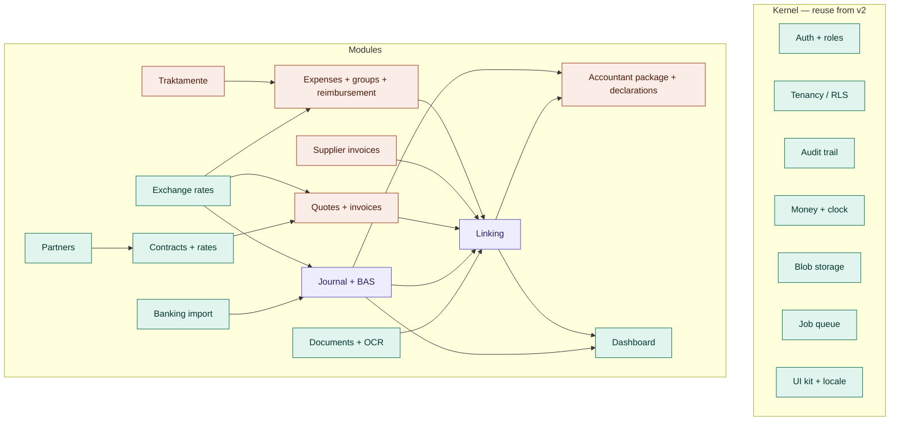
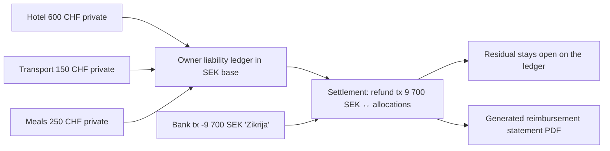

# v3 feature inventory — `af_core` (v1) vs `defterfab` (v2)

Version 2 · 2026-10-20 · Status: phase 0 — inventory closed · Owner: Zikrija
Companion: `excel-to-v3-mapping.md` (the current Excel, column by column).

Purpose: one table per module answering *what exists where, what v3 keeps, what it harvests, which mechanism it replaces*. Feeds the constitution, the strip list for the new repo, and the harvest specs.

Rule applied throughout: **simplify the mechanism, never the capability.** Every change is written as "keeps X; mechanism Y → Z".

---

## 0. Facts and figures

| | v1 `af_core` (OpsFab / AF-OPS) | v2 `defterfab` (DefterFab) |
|---|---|---|
| Built | 2025-11-07 → 2026-01-23 (11 weeks, 685 commits) | planning 2026-03-02 → 03-10, dev 03-09 → 03-17 (8 days, 273 commits) |
| Size | ~130 K LOC, 70 Prisma models, 43 API route groups, 60+ dashboard routes | 16 K LOC, 22 models, 19 services, 11 action files, 4 page areas |
| Tests | 61 Jest files + 129 Playwright e2e | 50 Vitest/Playwright files + architecture guard test |
| Stack | Next 15 / React 19 / Prisma 5 / SQL Server / NextAuth 5 / CASL / shadcn / Jest / puppeteer | Next 16.1 / React 19.2 / Prisma 7 / Postgres 17 RLS / Better Auth 1.5 / Inngest / Zustand / pino + Sentry / shadcn / Vitest / Biome / Docker + Container Apps |
| Method | feature-first with Claude in VS Code, audit-driven hardening afterwards | BMAD: brief → PRD → architecture → UX spec → 11 epics, story-per-branch, prep sprints, retros |
| Where it stands | ~95 % of a large scope; two invoice models coexist; tenant isolation patched by audits | foundations + documents done (Epics 0–5); banking started (6.0); invoices, reconciliation, exports never reached |

v1's budget went into features, v2's into foundations. v3 = v2's foundations + v1's feature knowledge (as specs, not code) + the Excel's business rules.

---

## 1. Decisions log

| # | Decision | Source |
|---|---|---|
| D1 | Accountant-software-agnostic: v3 organises, categorises, links and packages. The accountant books. No double-entry engine. | v2 PRD |
| D2 | BAS kontoplan = categorisation, not a ledger. Aliases (`Tr`, `Ut`, `Rep`, `Off`, `Acc`, `Evnt`, `Vat`) are the BAS short codes. | PRD + Excel |
| D3 | Dual-amount storage: object currency + SEK base + rate + rate source on every financial entry. | PRD |
| D4 | Exchange rates: ECB daily reference (today's Excel uses Riksbank via Power Query; equivalent). Bank implicit rate captured on transfer pairs. | Q1 |
| D5 | Document numbering: `number_series(tenant, series, next)` row-locked at issue; invoice series = `{client short}{yy}` (`VA26-001`); prefixes fixed; no settings UI. Quote and credit-note series: D21. | discussion + Excel |
| D6 | Business keys kept as **one fixed function** `Ex{group}-{alias}-{seq}_{date}_` / `InvoiceAF_{number}.pdf`; configurable pattern engine dropped. | Excel |
| D7 | One invoice model. Invoice form = invoice layout (edit / print modes of one component); PDF via Chromium from the print mode; PDF stored as a document at issue, downloadable forever. No sending from the app; "mark as sent". | 3.5, Q7 |
| D8 | Supplier invoices are a **separate module** (payable: document + partner + due date + unpaid state), not expense rows. | your correction |
| D9 | Expenses: group first-class (trip or batch); private payments create an owner liability; reimbursements are settlements, partial and cross-currency allowed; late receipts can join an old group. | Q6, your flow |
| D10 | Traktamente module: Skatteverket normalbelopp table per country/year; app computes days with the half-day rule from trip timestamps; you enter meals paid separately; countries CH, SE, EU. | Q5, Q7 |
| D11 | Time tracking dropped; invoice line = days × rate from the contract rate valid for the period. | Q2 |
| D12 | Swiss VAT kept: CH registration, 8.1 % on Swiss invoices, quarterly declaration period on each invoice, FTA form mapping harvested from v1. | Q3 |
| D13 | Accountant package: monthly; CSV per main account (SEK, CHF) + all PDFs of the period; savings CSV yearly; plus a generated summary (replaces the Excel you used to send). The Excel itself disappears. | Q3, Q4, Q5 |
| D14 | Owner cash planning (social charges, salary, what's left) moves from Excel into an owner-only dashboard widget — Growth phase. | Q4 |
| D15 | Roles: app superadmin, tenant admin (owner), accountant (read-only), editor (later). One real user today; RBAC through one `can()` function so CASL-style rules can be plugged in later. | Q7, 3.1 |
| D16 | Multi-tenancy by RLS kept as built; tenant-switcher polish and the second-tenant journey skipped. | Q6 (first round) |
| D17 | Background jobs: Postgres-backed queue (pg-boss) in the same container replaces Inngest. No external job service, no signing key; runs offline on the homelab. Settled 2026-10-20. | Q8 |
| D18 | Linking module owns the single `link` table; every other module registers as linkable; suggestions, graph and exports are read models. Invariants in DB and service. | your §10 |
| D19 | Layout: full-width app layout (collapsible sidebar, dense content, three page archetypes: list / entity / work). v2's centred `max-w-5xl` pages are replaced. See `ui-conventions.md`. | your UI feedback |
| D20 | Tables: one kernel `DataTable` with Excel-style typed header filters — server-side distinct values with counts, date hierarchy year→month→day, number ranges, text operators — state in the URL, column prefs per user. v1 `advanced-table` is the behaviour reference. See `ui-conventions.md`. | your UI feedback |
| D21 | Document numbers always start with the client code and year: invoices `VA26-001`, quotes `VA26-QT-001`, credit notes `VA26-CN-001` — one gap-free counter per client × year × type. Supersedes the `QUO26` / `CN-VA26` series of D5. | open-questions B1 |
| D22 | Quotes live in the invoice table (`type = quote`), valid 30 days by default, convert = copy into an invoice draft, PDF stored at issue. PDF money format `CHF 25'944.00` in every language, 2 decimals. | B2, B3 |
| D23 | Swiss VAT on invoices: reverse-charge sentence printed automatically for EU-business clients under the SE registration; CH-registration invoices to non-Swiss clients print the export line; declaration period derived from the issue date and overridable per invoice; every issued invoice counts. Acquisition tax (383) not applied by default (foreign SaaS is Swedish reverse charge, booked by the accountant), per-supplier-invoice flag if ever needed. Minimal `swiss_vat_declaration` record per quarter so "declared" is derived on each invoice. | B4, D-c, D-e |
| D24 | Contract rates: the rate valid on `period_start` applies (a change inside the period splits the line); the previous rate closes on `valid_from − 1`, overlaps rejected; `billing_rate` derived. Unit: enum `rate_unit` with the single value `day` on rate and invoice line — new units are an enum migration, never a code path. One contract per currency. | B5, B6, D-j |
| D25 | Banking: dedup key `sha256(account, date, amount, currency, sender, recipient, name, additional details, message)` + in-file occurrence index; `Balance` (end-of-day only) and `Own notes` excluded; `Date` and `Booking date` headers both accepted; rules match `Name`, `Additional details` and `Message`. Transfer pairs: `CHANGE CHFSEK` in details and message, CHF row negative, SEK row positive, implied rate = SEK ÷ CHF. Short-payment tolerance `delta ≤ max(0.05, 0.5 %)` → bank fees. Receipt allocation currency = invoice currency (DB constraint). | B7, B8, B9, D-a |
| D26 | Expenses: settlements FIFO by expense date with per-row override, residual stays open; exchange difference on cross-currency settlements → BAS 3960/7960 (accountant confirms); card-FX expense = receipt amount in its currency + the bank row's SEK as base (rate source `bank`). Swiss VAT payments are expenses of kind `vat_payment`; no mileage; superseded statements kept with a flag. | B10, B11, D-e |
| D27 | "What a document became" is a link: kind `created_from` (expense / supplier_invoice → document), one origin per document (partial unique index), no fields on the document. One `links` table for every relationship stays the architecture (D18). | B12 |
| D28 | Supplier invoices: business key `SI{group}-{alias}-{seq}` (`SI213-Acc-01`), same per-group counter as expenses, stored file `{key}_{date}_{vendor}.pdf`; CH input VAT reclaimed (400) for purchases under the CH registration; no paying-account constraint (card = SEK account, FX like D26); cancel-not-delete in retention; "copy last month". | B13, D-g |
| D29 | Traktamente: rate year and half-day rule per calendar day; day trips nothing tax-free; meals as counts; night allowance dropped from the UI; the per-diem breakdown is its own PDF document. | B14, D-f |
| D30 | `document_type_prefixes` and `document_key_counters` dropped (migration `20261020200000_drop_v2_prefix_tables`). | B15 |
| D31 | Accountant package: `.xlsx` summary only; an invoice issued in June and paid in July appears in both months; no OCR line-item sheet; the savings CSV joins the package of the month it is imported in (December or January); a **year package** = the same generator over 12 months. | D-b, D-i |
| D32 | Documents: identical upload → `Use existing` (primary) / `Upload anyway` (owner); fuzzy duplicate ±1 % / ±7 days / same partner + currency, "Create anyway" on HIGH needs a note; OCR quality two levels; archive only inbox rows; keyboard map `j k x a o i e l d r z u ? Enter 1-3`. | D-d |

---

## 2. Module map

Green = v2 code reused (after the four structural moves). Orange = rebuilt on the v2 foundation from v1 behaviour + Excel rules, harvested as specs and fixtures. Purple = new to the PRD, informed by v1's matching code.

---

## 3. Module by module

Verdict legend: **v2** keep v2 code · **harvest** rebuild on v2 foundation from v1 + Excel · **new** build to PRD · **drop**.

### 3.1 Auth, users, roles — v2

| | v1 | v2 |
|---|---|---|
| What | NextAuth v5 + CASL; `Permission` / `Role` / `RolePermission` / `UserTenant`; admin UI for users, roles, tenants | Better Auth 1.5; organisation = tenant; owner / accountant roles enforced in the action middleware; sidebar filtered by role |
| Keeps | superadmin (app-level), tenant admin, accountant read-only, editor later; admin pages for users and tenants (Epic 9) |
| Mechanism | CASL permission matrix → one `can(identity, action, subject)` in the kernel backed by a role map; guard test forbids role checks outside it. CASL can be plugged behind `can()` later without touching call sites |

### 3.2 Tenancy and isolation — v2

| | v1 | v2 |
|---|---|---|
| What | `tenantId` filter by convention; two audit rounds closed gaps | Postgres RLS, tenant-scoped client, `CallerIdentity` on every service call |
| Keeps | full isolation, two-tenant capability |
| Mechanism | filter-by-convention → RLS. Tenant-switcher polish and Journey 4 not built |

### 3.3 Partners — v2 + v1 contacts

| | v1 | v2 |
|---|---|---|
| What | `Partner` + `Contact`; separate clients / suppliers pages | `Partner` with `types[]`, org + VAT number, labelled external identifiers (supplier number etc.), soft-delete, tabbed entity view; pattern-setter module |
| Keeps | everything in v2 + contact persons + per-partner defaults (BAS category, currency, payment terms) + partner short code (`VA`) + 360° view: documents, transactions, invoices, supplier invoices, contracts |
| Mechanism | three pages → one partner hub filtered by type |

### 3.4 Contracts and rates — v2 + v1 rate history

| | v1 | v2 |
|---|---|---|
| What | `ClientRate` effective-dated (`lib/rates/lookup.ts`); `Project` budgets; `PriceList` / `PricingRule` / `ServiceCatalog` | `Contract`: client, date range, employee, rate, currency, payment terms, VAT rule, labelled external reference (PO) |
| Keeps | currency per contract (CHF / EUR / SEK), payment terms, PO and other labelled references, **rate history** (`ContractRate` valid_from / valid_to; 1 000 in 2025, 1 200 in 2026), rate stored immutably on each invoice line |
| Mechanism | price lists, pricing rules, service catalog, project budgets → dropped; one contract with dated rates |
| Status | **Built 2026-10-20** (phase 1, first slice): `contract_rates` with the exclusion constraint, `rateFor`, derived current rate, Rates section, en/fr — `docs/contracts.md`, `specs/contracts/`. `billing_rate` carried over and dropped (D24). |

### 3.5 Quotes and invoices — harvest

| | v1 | v2 |
|---|---|---|
| What | `Invoice` + `InvoiceV2` both live; lines, payments, credit notes, templates, period label, PO / contract / vendor-ID labels, en/fr, approval; `Quote` → invoice; puppeteer HTML templates | not built (Epic 10) |
| Keeps | quotes → invoices; lines (days × rate, discount); period label; PO number per invoice; partner and contract labelled identifiers printed; VAT per registration (CH 8.1 %, SE moms, reverse charge); credit notes referencing the original; en/fr now, sv later; logo; lifecycle draft → issued → sent → paid / credited; paid amount and delta derived from bank links; CH declaration period on each invoice; PDF downloadable any time |
| Mechanism | two models → one; 260-line numbering → `number_series` per `{client}{yy}`; separate preview and PDF → one component with edit / print modes, Chromium renders print mode; PDF generated once at issue and stored as a document; templates-of-invoices and approval step dropped; email sending not built (mark as sent) |
| Status | **Part 1 built 2026-10-20**: model, totals, lifecycle, derived states, list read model — `docs/invoices.md`, `specs/invoices/`. Part 2 (sheet, print, PDF, pages) next. |

### 3.6 Supplier invoices — harvest, own module

| | v1 | v2 |
|---|---|---|
| What | `SupplierInvoice` + lines + payments, posted to ledger | none |
| Keeps | a payable: document (OCR-reviewed) + partner + invoice number + due date + amount + currency + status unpaid / paid; due-date view on the dashboard; link to the paying bank transaction; VAT amount for declarations |
| Mechanism | ledger posting → category + link; lines only when a VAT split needs them; "paid" derived from the link, never typed |

### 3.7 Expenses, groups, reimbursement — harvest + Excel rules

| | v1 | v2 |
|---|---|---|
| What | `ExpenseClaim` + lines + categories + payments; reimbursement page; `CompanyPurchase`; `PayrollEntry` | PRD: manual journal entries for prepaid expenses and claims; reimbursement entry-to-entry linking (Epic 7.4) |
| Keeps | every cost the company bears: company-card purchases (Nordea rows), private purchases to be refunded, Swiss VAT payments, subscriptions; **groups** (`213 — Travel to CH in March 2026`, a month of subscriptions) with late additions; `paid by` ∈ {AF SEK account, AF CHF account, private SE, private CH}; status derived: paid / to refund / refunded; business key per expense; comments and `document_missing` flag |
| Mechanism | claim-per-expense → **owner liability ledger + settlements** (see below); `CompanyPurchase` → an expense paid from a company account; payroll → journal category with recurring templates |

Reimbursement model (your flow: 1 000 CHF paid privately, 900 refunded, maybe in SEK, rest stays in the company):

- Each private expense carries its SEK base (ECB rate of its date). The liability ledger is the running sum of open SEK bases.
- A settlement links one refund bank transaction to a chosen set of private expenses with allocated SEK amounts (FIFO proposed, manual override). Partial amounts allowed; the unallocated remainder stays open — exactly the "leave some in the company" practice.
- Cross-currency refund (CHF expenses, SEK refund) nets in SEK base; the rounding goes to an exchange-difference category.
- The settlement generates a **reimbursement statement PDF** listing the expenses refunded — the justification document the refund transaction never had.

### 3.8 Traktamente — harvest calculator, own module

| | v1 | v2 |
|---|---|---|
| What | `TravelAllowance` + rate importer (478 lines) + calculator (385) | none |
| Keeps | per-country, per-year normalbelopp table; trip = group with departure / return timestamps and country; **day count with the half-day rule** (departure after 12:00 / return before 19:00); meals paid separately entered per trip → deduction; night allowance; result = one `per_diem` expense in the group, refunded through the settlement flow |
| Mechanism | rate importer → a one-screen yearly table you maintain from Skatteverket's list |

### 3.9 Documents and OCR — v2 + v1 extras

| | v1 | v2 |
|---|---|---|
| What | `Document` + polymorphic `DocumentLink` + `OcrResult`; inbox / process / queue; suggestion engine; duplicate detection; keyboard shortcuts and undo | upload + validation → blob → business key → async OCR → review overlay (line items, VAT) → library → retention; `documents.ts` 824 lines |
| Keeps | the whole v2 pipeline; business key as filename; duplicate detection; inbox UX (keyboard, undo); document types incl. `bank_statement`, `reimbursement_statement`, `invoice_pdf` |
| Mechanism | configurable prefixes → fixed key function (D6); `documents.ts` split into upload / review / library / retention during the feature-folder move; links move to the linking module |

### 3.10 Banking — v2 + v1 rules

| | v1 | v2 |
|---|---|---|
| What | accounts, imports, transactions; modular CSV parsers; `CategorizationRule` + matcher; inbox / reconcile pages | app-level `BankFormat` library + `BankAccount` per tenant; `csv-parser.ts` with dedup hashing |
| Keeps | three Nordea accounts (SEK main, CHF main, savings) each with its own CSV import; dedup on re-import; counterparty key; learned categorisation rules (OPENAI → OpenAI, MSFT → Microsoft); bank fees auto-categorised with `no_document_needed`; **transfer pairs** (`CHANGE CHFSEK`) detected and linked, bank implicit rate captured |
| Mechanism | three pages → one transactions workbench with filters; reconcile page → linking module |

### 3.11 Exchange rates — v2

| | v1 | v2 |
|---|---|---|
| What | ECB sync + converter + admin page with manual rates | `EcbRate` + SDMX fetch + gap detection + `Clock` |
| Keeps | daily ECB rates, weekend / holiday fallback, gap flag > 3 days, rate immutable per entry; manual override on the entry only |
| Mechanism | admin page + table-level manual rates → scheduled job + dashboard flag |

### 3.12 Journal and BAS — new to PRD

| | v1 | v2 |
|---|---|---|
| What | double-entry: journal lines, chart of accounts, VAT codes, fiscal years, posting service (612) | PRD: chronological ledger of financial events with BAS category, flags, notes, filters; BAS preferences done |
| Keeps | every bank transaction becomes a journal entry (SEK base, rate, source); manual entries for prepaid / forfait; recurring templates (salary, Skatteverket); BAS category per entry with partner defaults; filters by period / currency / partner / category / VAT registration |
| Mechanism | double-entry → categorised single-entry journal; SIE export out of scope (needs debit/credit) |

### 3.13 Linking — new, informed by v1

| | v1 | v2 |
|---|---|---|
| What | `matching.ts` 1 738 lines + 643 test lines: per-entity candidate finders, amount / cross-currency tolerance, date window, reference in bank text, partner name → HIGH / MEDIUM / LOW with reasons; `@xyflow/react` graph; three payment-allocation tables | Epic 7 backlog |
| Keeps | scored suggestions with reasons; one transaction ↔ many invoices and the reverse; tolerance for short payments and bank fees; link kinds: `justifies` (tx ↔ document / invoice / supplier invoice / expense), `transfer` (tx ↔ tx), `settles` (tx ↔ settlement), `belongs_to` (document ↔ partner / contract); unlinked transactions and unlinked documents views; relationship navigation; graph view |
| Mechanism | three finders → one generic finder over registered linkables; three allocation tables → one `link` table with `allocated_amount`; graph = read model; DB-level invariants (allocation ≤ amount, no delete while linked in retention), audit on every link / unlink; v1 tests → fixtures; property-based tests on allocation math |

### 3.14 Dashboard — v2

| | v1 | v2 |
|---|---|---|
| What | dashboard; `EventLog` + `Notification` + preferences (991 lines) | business-pulse + action-items shell; FR29–31 |
| Keeps | briefing since last visit; action items: documents to review, unlinked transactions, supplier invoices due, open liability to owner, rate gaps; accountant view; **owner cash-planning widget** (D14, Growth) |
| Mechanism | notification system → audit-trail-driven briefing |

### 3.15 Reports, exports, declarations — harvest, reframed

| | v1 | v2 |
|---|---|---|
| What | P&L, balance sheet, VAT report, SIE, Swiss VAT return prep with FTA form mapping | Epic 10 backlog |
| Keeps | monthly accountant package (D13) with a generated summary; Swiss VAT quarterly prep (form-field mapping, H6); Swedish moms prep; SCB filters; management P&L from categories if cheap |
| Mechanism | statutory statements and SIE → dropped; package = zip built from a read model |

### 3.16 Settings — v2 minus prefixes

Keeps tenant profile, VAT registrations with rate schedules, bank accounts + formats, BAS preferences (active, favourites, aliases, translations), personal locale, table preferences, app-level admin (currencies, bank formats, rate source). Drops `DocumentTypePrefix`. Adds traktamente table, invoice series, recurring entry templates.

### 3.17 Dropped from v1

Time tracking and `Project` budgets, `PriceList` family, `ServiceCatalog`, `PricingRule`, `PayrollEntry` module, `Tag` / `EntityTag`, `Notification` system, `DimDate`, `table-test`, `expenses/test-upload`, `admin/debug`, second invoice model, two generations of translation files, the 3 112-line `lib/validation` (validation at each module's action boundary instead).

---

## 4. Cross-cutting

| Concern | v1 | v2 | v3 |
|---|---|---|---|
| Money | Decimal + helpers; SEK literals removed by audit | Decimal through services, number at display; `.toNumber()` lint rule deferred | v2 + the lint rule |
| Dates | mixed | `Clock`, TIMESTAMPTZ, sv-SE display | v2 |
| Validation | one 3 112-line lib | Zod 4 at the action boundary | v2 |
| Errors | throw `AuthError` | return `AppError`, never throw from actions | v2 |
| Audit | `EventLog` | append-only `AuditLog` with provenance | v2 |
| Jobs | none dedicated | Inngest (OCR) | pg-boss in-container (D17, settled): OCR, ECB sync, PDF, package build |
| PDF | puppeteer, same HTML as preview | none | Chromium from the print mode of the invoice component; reimbursement statement and package summary the same way |
| OCR | Azure DI, sync | Azure DI, async job, review overlay | v2 |
| Storage | Azure Blob | Azure Blob + Azurite, blob proxy | v2 |
| UI kit | shadcn, TanStack Table, `advanced-table` filters | shadcn, `DataTable`, Zustand tenant stores, `LocaleProvider`, centred pages | v2 kit + v1 filter behaviour (H13); full-width layout (D19); i18n keys from day one (en, fr; sv later) |
| Testing | Jest + 129 e2e | Vitest co-located + Playwright + architecture guard + factories | v2 + flaky-test quarantine + property tests on money and allocations |
| CI / deploy | GH Actions, App Service, SQL Server | GH Actions with Azurite e2e, Docker, Container Apps | v2 (+ Chromium in the image) |
| Docs | large plan documents | `docs/index.md` wiki per pattern | v2 convention + spec-kit specs |
| Observability | logger | pino + Sentry, request context partly deferred | v2 |

---

## 5. What each version got right — and the trap

**v1 right:** invoices that look right (one HTML for preview and PDF), effective-dated rates, scored matcher with reasons and real tests, polymorphic document link, Swiss VAT mapping, a graph people click.
**v1 trap:** scope — 70 models, pricing engines, payroll, time tracking, notifications; two invoice models mid-migration; isolation by convention.

**v2 right:** RLS, a service layer that cannot import the framework (and proves it), audit with provenance, Decimal and clock discipline, documents pipeline with a real review UI, CI with emulators, docs wiki, a PRD whose scope is still correct.
**v2 trap:** ceremony and configurability — four prep sprints and six retros for five epics; settings pages for constants; 100 % of the budget before the first business feature.

**Excel right:** groups, business keys, `paid by`, the transfer pair, the half-day rule, monthly rhythm. **Excel trap:** statuses typed by hand, links held in a text column, supplier invoices mixed with claims.

v3: v2's constraints, v1's appetite, the Excel's rules, and one guard — a setting exists only when two tenants need different values today.

---

## 6. Harvest list → specs

| # | Spec | Source |
|---|---|---|
| H1 | Invoice + credit note model, lifecycle, quote → invoice, series per client-year | v1 `InvoiceV2`, `Quote`, `app/api/invoices`; Excel *Income* |
| H2 | Invoice component (edit / print), en + fr strings, Chromium PDF, stored at issue | v1 `lib/pdf/*` |
| H3 | Match scoring rules + fixtures | v1 `lib/banking/matching.ts` + tests |
| H4 | Learned categorisation / counterparty mappings | v1 `categorization-*.ts`; Excel *Column1* |
| H5 | Contract rate history | v1 `lib/rates/lookup.ts` |
| H6 | Swiss VAT return field mapping + declaration period per invoice | v1 `swiss-vat-types.ts`, `docs/features/swiss-vat-declaration.md`; Excel *VAT Declaration* |
| H7 | Duplicate detection + inbox UX | v1 `duplicate-entity-detection.ts`, last `documents/inbox` commits |
| H8 | Expenses, groups, owner liability ledger, settlements, reimbursement statement | v1 `ExpenseClaim*`, `expenses/reimburse`; Excel *Expenses*; your flow |
| H9 | Traktamente: normalbelopp table, half-day rule, meal deductions | v1 `travel-allowance/calculator.ts`; Excel *Travel Details* |
| H10 | Supplier invoices as payables | v1 `SupplierInvoice*` |
| H11 | Banking: three-account import, transfer pairs, bank fees rule | v2 `csv-parser.ts`; Excel *Bank Statement* |
| H12 | Accountant package: monthly zip + generated summary | Excel (all three sheets) + D13 |
| H13 | DataTable header filters: checkbox distinct values, date hierarchy, number range, text operators, toolbar | v1 `components/advanced-table/*`, `app/api/*/available-values` routes |

---

## 7. Remaining open points

None. The harvest questions (B1–B15, D-a–D-j) were answered on 2026-10-20 and are D21–D32 above; the full question / answer / decision table is `open-questions.md`. Two items still wait for the accountant's confirmation, not for a decision: the BAS pair for exchange differences on settlements (D26) and whether any purchase ever falls under CH acquisition tax (D23).
