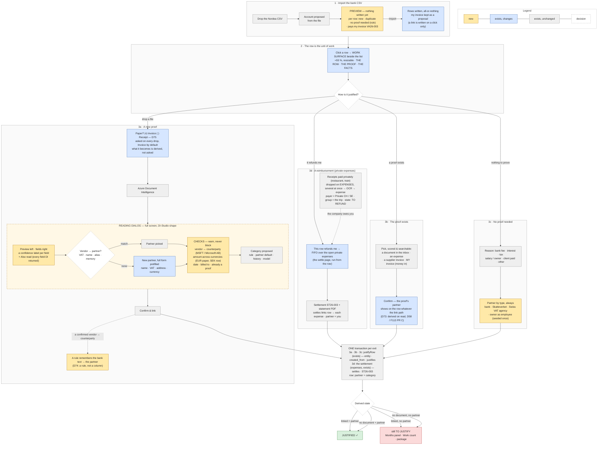

# Review 2026-10-31 — Justify, reworked: the owner's redesign

> Planning only, from a chat with the owner on 2026-10-31. No code, no spec yet. The owner's verdict after the first real proofs (F124, B1): "the workflow is spaghetti — the interface, the UX and the process to justify every bank transaction". This page writes his target flow down as he described it (§1), what exists under each step and what changes (§2), the three things that are not UX but rules or facts (§3–§5), the screens (§6), the dispatch (§8) and the open decisions in one batch (§9). Examples are invented (D51). Goes to the repo as a docs PR; the specs follow the lanes of [[roadmap]] *How we work*. **Second read 2026-11-04** (§11): three corrections against what `main` already decided — D73 derives the partner on read (F113 PR C) instead of writing it on every link path, D74 is a rule rather than a new column, the FX tolerance has one home — and the decisions now live where a session reads them ([[feature-inventory]] D73–D75, [[features]] F127–F131, [[roadmap]], `specs/justify/tasks.md`).

## 0. The one-line verdict

**F97 put the right verbs on the row; it put them in the wrong box.** Five days after [[review-2026-10-26]] every mechanic the owner asked for exists — drop the proof on the row, OCR, compare, create & link in one transaction, no proof needed, receipt lost, scored pickers. But it all lives in one narrow docked panel that stacks *Justify · As the bank said · Links · Suggestions · Category · Proposed · History*; the reading it shows is a dozen fields with one quality word; *Fix the reading* leaves the row for `/documents/[id]`; and a row can end up *linked* with no partner. The rework is about **the shape of the screen, the depth of the reading, and one rule** — not about new mechanics.

```
today    /banking ─► row ─► a 380 px docked panel: 7 sections, a compare card, "Fix the reading →" leaves the row
                                                   the import dialog writes first, shows after

target   /banking ─► Import CSV ─► PREVIEW (account · new / duplicate · "no proof needed" · my invoice found) ─► Import
                 ─► row (highlighted, the list stays) ─► a WIDE work surface
                        ├─ drop a file ─► invoice or receipt? ─► DI ─► READING DIALOG: preview | fields + confidence ─► partner ─► checks ─► Confirm
                        ├─ pick the proof that exists (document · expense · SI · my invoice)
                        └─ no proof needed ─► a partner, always ─► done
```

## 0.1 The workflow in one picture

Yellow = new · blue = exists, changes · grey = exists, unchanged · dashed = a decision. GitHub renders it; the source is this block (no PNG copy — it would drift).



## 1. The target flow — the owner's twelve points, numbered as he gave them

| # | The owner said | In one line |
|---|---|---|
| 1.1 | Upload the CSV: a modal with the proposed account, a preview of the rows, a first state for rows that need no document (salary, Skatteverket…) | **Preview before writing** |
| 1.2 | See there if the transactions were already imported | duplicates per row, in the preview |
| 2.1 | Click a row: it is highlighted, its detail shows — "this is where the big work happens" | **the row is the unit of work** (unchanged since 10-26) |
| 2.2 | The current modal is too small; keep the list visible; a page or a small modal is worse; "a way bigger modal would be more efficient" | **a wide work surface**, the list still visible → O1 |
| 2.3 | Drop a document on the row → "invoice or receipt?" → Azure Document Intelligence | the paper question, not the entity question → D75 |
| — | DI through the app reads less than DI Studio does; "maybe the infos come not all at once?" | **the mapper drops them**, not the API → §3 |
| 2.4 | A big modal like DI Studio: preview left, extracted fields right | **the reading dialog** → §6.3 |
| 2.5 | Vendor picked automatically when it is a partner, else create one with everything (address too, not only name + VAT) | exists; move it into the dialog |
| 2.6 | "I don't understand Category (Financial / Relationship)" | explained in §2, row 2.6; hidden in this flow |
| 2.7 | A confidence label per field, like DI Studio | per-field confidence → §3 |
| 2.8 | Warn when the document and the bank row disagree — vendor vs counterparty (MSFT vs Microsoft AB), currency (EUR / USD invoice, SEK row) | **consistency checks**, never a block → §4 |
| 2.9 | A row can be linked to one of *my* invoices; detect it at import when the message carries my invoice number | exists on the row; **proposed at import** → F128 |
| 2.10 | Confirm; the row shows *linked* | exists (`justifyRow`, one transaction) |
| 2.11 | A row justified by an OCR-read document has no vendor / partner — "does not make sense" | D33 was already reversed by D58 — what is missing is its build (F113 PR C) → **D73** |
| 2.12 | A row may need no document, but it always needs a partner (vendor, employee for salary, the bank, the client, Skatteverket, the Swiss VAT agency) | **partner on every row** → D73 |
| 2.13 | (2026-11-02) "Where do I record the private expenses (restaurant, train) the business refunds me? I thought the journal would hold all bank transactions + private expenses" | **Expenses, payer = a private instrument**; the one list of both is the package → §5.1, O7 |
| 2.14 | (2026-11-02) The flight paid by card and the train paid privately both belong to the Switzerland trip — can they be grouped? | **Expense groups already span the payers**; the one-click must propose the trip group, not the month → §5.2 |

## 2. Step by step — what exists, what changes

| # | Today ([[banking]], [[linking]], [[document-review]]) | Change | Lane |
|---|---|---|---|
| 1.1 | `ImportDialog`: file → the account from the file name + the first row's currency (`detectAccountAction`) → **import** → summary (period, rules applied, balance chain) | A **dry-run step** between file and Import: `previewImport` = parse + dedup plan (`planImport`) + the rules in dry run (`applyRules({dryRun})`) + the balance chain (`balanceChain`) + the row's text searched for an issued invoice number (`referenceTokens`, the scorer's 40-point claim) — rendered as a table with one *Will be* column: *new · duplicate · no proof needed (rule Nordea fees) · pays VA26-003 (proposed)*. Nothing written until **Import**; the import stays all-or-nothing (F109). | LIGHT — a read model, no rule |
| 1.2 | `duplicateCount` in the summary, after the write | the *duplicate* word per row in the preview | with 1.1 |
| 2.1 | `TransactionTable` + `TransactionPanel` (docked, `?open=<id>`) | unchanged: the row is the unit, the list stays | — |
| 2.2 | the docked details panel of the kit (~380 px), seven `DetailsSection`s | the **work surface**: the panel widened and resizable (default ≈ 55 % of the viewport), three zones instead of seven sections — *the row* (bank facts + state, one line), *the proof* (drop zone · candidates · links), *the facts* (partner · category · note). History and *As the bank said* become collapsed footers. O1 decides the container | LIGHT |
| 2.3 | the panel's *Create as* toggle (expense / supplier invoice) and the upload's type | the drop asks **what the paper is** — *Invoice* (printed, a number) or *Receipt* (a till slip, a photo) — **Invoice selected by default** (O5, decided 2026-11-03). **What it becomes** (expense / supplier invoice) is derived as today (`proposeKind`: a card purchase → expense; an invoice number or a VAT number → supplier invoice) and shown as a word, not asked | D75 |
| 2.4 | the **compare card** inside the panel; *Fix the reading →* opens `/documents/[id]` | the **reading dialog**, full screen: the review page's viewer on the left (react-pdf, zoom, rotate — exists), the fields on the right with a confidence label each, the row's facts pinned on top, the compare verdict and the warnings (§4) under the fields, *Confirm* once. The review page stays for the other direction (a receipt that arrives before its row) | LIGHT, after §3 |
| 2.5 | `matchPartners` (VAT 100 · name 80/60/40 · address 20 · type 10), `PartnerMatchCard` from 60 %, *New supplier* with name, VAT, address (T026), D70 refuses a duplicate name / VAT and picks the existing one | the same card, in the dialog, first thing under the fields. *New partner* opens the **full partner form** pre-filled: name, VAT, address, country, default currency = the document's, type by the row's direction (vendor out, client in), short code empty | exists; moves |
| 2.6 | Documents carry a **category** — *financial* (expense, invoice, receipt: what the accountant gets) or *relationship* (contract, NDA, certificate: the company's own papers) — and a sub-type. It decides **who may read it** (the accountant sees financial only, `can(read, relationship_document)`), **what *Make it…* offers** (a contract becomes nothing), and **the OCR model** (layout for relationship). It is a documents-module concept from the document-first days | **not asked in the row flow**: a file dropped on a bank row is financial by definition; the category is set, not chosen. It stays on `/documents` for the papers that are not proofs | with D75 |
| 2.7 | one `confidence` per document → one word: *high / low / none* | per field, from DI's own `confidence` → §3 | §3 |
| 2.8 | the compare card: amount equal / off by Δ / another currency; the days; the partner match % ; *Not addressed to {company}* (D53) | the **checks list** of §4 | F131 |
| 2.9 | incoming rows: *Suggestions* finds the invoice (reference 40 pts, amount, date, partner); `Enter` on HIGH | **also at import**: the preview names the invoice; Import keeps it as a proposal; one click on the row confirms (the link is written on a click, never by the import — D60) | with 1.1 |
| 2.10 | `justifyRow`: entity + `created_from` + `justifies` + the row's partner and category, one transaction, a refused step rolls back | unchanged | — |
| 2.11 | D33 (2026-10-21) was reversed by D58 (2026-10-26) and its build is `specs/banking/one-table.md` US4 / FR-006 — **F113 PR C, derive the partner and BAS from the proof on read**, parked *after B1* (D65). F97's click writes the partner (so one path is covered), **Suggestions · Apply HIGH · Link to… · the inbox's Enter · the payment picker** do not — exactly the row the owner saw: linked, no partner | **D73 (a)**: PR C pulled forward — `effectivePartner(row, links)` on read, a typed value wins, never written; every link path at once, links made before included; no change at five call sites | FULL |
| 2.12 | `no_document_needed` + a BAS code (fee 657 · tax 251 · salary 721 · interest 831 — four digits after D68's migration), no partner; rules may carry a partner | **D73 (b)**: the *no proof* reasons are the one place a partner is **typed** (there is no proof to derive from) — offered by type, seeded once; a row counts as justified only with a partner | FULL |

## 3. The DI reading — why the app shows less than DI Studio

Read from `src/kernel/ocr/ocr.ts` (`mapAnalyzeResult`), not a guess:

1. **The mapper keeps ~15 fields and drops the rest.** `prebuilt-invoice` returns ~30 (`PurchaseOrder`, `AmountDue`, `PreviousUnpaidBalance`, `PaymentTerm`, `ServiceAddress`, `ShippingAddress`, `CustomerAddress`, `TaxDetails` per rate, `VendorAddressRecipient`…) plus key-value pairs and tables; the app maps vendor, VAT number, address, dates, totals, number, billed-to, payment details, items. `rawResponse` is stored whole ("provenance") and **read by nothing**.
2. **Per-field confidence is thrown away.** Every DI field carries its own `confidence`; the app keeps `documents[0].confidence` only and turns it into one word (*Review extracted data* / *Low confidence*).
3. **Until 2026-10-29 every expense was read with the receipt model**, PDFs included — ~6 fields, no vendor name, no VAT, no number (D69 fixed it: a PDF is read as an invoice whatever it becomes). Documents read before that day keep their thin reading until *Re-run OCR*.
4. **Not "in parts".** `getLongRunningPoller(...).pollUntilDone()` waits for `succeeded`; the Studio shows the same response — all of it.

**Change (F127)**: `OcrExtractedData` keeps the whole `fields` map as `{ value, confidence, content }` per field (the typed subset stays as today, derived from it); the dialog shows the mapped fields with a label per field — `·` ≥ 0.90, `?` 0.70–0.90, `!` < 0.70 — and the unmapped scalar ones under *Also read* (read-only, searchable, copy); the array fields (`Items`, `TaxDetails`) show as *N entries* and open under *Lines* — never flattened. JSONB, no migration; old documents get it on *Re-run OCR* (exists). Optional, O3: DI's `queryFields` feature for the Swedish paper fields the prebuilt model has no slot for (OCR number, Bankgiro, *Er referens*) — costs more per page.

## 4. Consistency checks — the warnings list (never a block)

One pure function, `checkProof(row, reading, partner, memory) → Warning[]`, run in the dialog; every warning is one line; *Confirm* stays available; the warnings the owner confirmed over are written into the audit row of the link (he saw them) — no new table.

| Check | Green when | Warning text (invented) |
|---|---|---|
| **Vendor ↔ counterparty** | any one of: the VAT number matches a partner; the counterparty key was linked to this partner before (`memoryForRow`, exists); a **rule** names this partner for the key (D74 — the confirmed warning becomes a rule: `MSFT` → Microsoft AB, `OPENAI *CHATGPT SUBS` → OpenAI); a name token matches (`nameTokens`, exists — but `MSFT` never matches *Microsoft*: four letters, no common prefix) | *The document says Microsoft AB, the bank says MSFT — confirm it is the same; a rule will remember it* |
| **Amount across currencies** | the document's amount at the ECB rate of the booking date (`withForeignBases`, exists) is within the tolerance of the row's base — **one figure per kind from `kernel/money` (`fxTolerance(kind)`)**: **card purchases (`Kortköp`) 4 %** (O4 — the card scheme's margin and a possible fee), every other row the kernel's cross-currency figure, today the scorer's 6 % (`CROSS_CURRENCY_TOLERANCE`, moved there, not changed — lowering it changes which suggestions are HIGH, a question of its own). Not a seventh tolerance: the settlement tolerance (`max(0.05, 0.5 %)`, D25) stays the rule for *paid*, the transfer pair's 5 % on the rate stays its own | *EUR 12.00 at 11.42 = 137.04 SEK; the bank took 141.90 SEK (+3.5 %) — a card margin?* |
| **Amount, same currency** | equal within the kernel's tolerance (`isSettled`); else the difference is named, the link allocates the row's amount (today's rule, F97 AS2) | *Off by 7.20 SEK — the invoice shows 1 290.00* |
| **Date** | a card row 0–5 days after the paper; an invoice inside its terms window (`paymentWindow`, exists) | *Booked 23 days after the invoice date — late payment?* |
| **Billed to** | the name or VAT number fits the company (D53, exists) | *Not addressed to AnalyticsFab AB* |
| **Already a proof** | the document justifies no other row; the supplier invoice number is new (D35, exists); the bytes are new (exists) | *This document already justifies the row of 2026-07-08* |
| **Currency of the entity** | the document's currency was read (F61-b) | *No currency read — the amount is not compared* |

Note the 10-26 rule stands: **every point is a claim and every claim is true**; a warning says what was compared and the numbers, never "looks wrong".

## 5. The rules that change — two decisions (FULL lane)

**D73 — a justified row names a partner.** Today *justified* = `linked | no_document`. Decided (O2): a row counts as justified only when it also names a partner — typed or derived; the Months panel, the *Work* count, the sidebar badge and the package treat *linked · no partner* and *no document · no partner* as *to justify*, and the state label says so. How the partner gets there:

- (a) **Derived from the proof, on read** — ~~the proof's partner written on every link path (`applySuggestion`, *Apply HIGH*, *Link to…*, the inbox's `Enter`, the payment picker)~~ *second read 2026-11-04*: that re-decides F113 PR C with the opposite mechanism. D58 already reversed D33 and `specs/banking/one-table.md` US4 / FR-006 is its approved build: `effectivePartner(row, links)` / `effectiveCategory` read in banking — the proof's partner and BAS when the row has none typed, a typed value wins, never written. One rule covers every link path, the links made before, and the package; no call site changes. D73 (a) = **PR C pulled forward** (it waited for B1 under D65, which the owner lifted).
- (b) **Typed for the *no proof needed* reasons** — there is no proof to derive from. Each reason offers a partner by **type**: *bank fee / interest* → the bank, *tax* → the tax agency, *salary / owner* → the owner as employee, *client paid* → the client (the picker); a learned rule carries it, as rules already can. **Four partners seeded once per tenant** (O2): the bank, Skatteverket, the Swiss FTA (the VAT agency), the owner as employee — ordinary, editable partners; the migration seeds the tenant that exists, `createTenant` the next ones. Partner type: `authority` joins `client | vendor | employee` (`partners.types` is a string array — no migration) for the two agencies; the bank is a vendor.
- **Rows that exist**: every rule-justified fee / tax / interest row on the box has no partner today, so the day D73 lands they re-open in the Months panel. The migration backfills `partner_id` on `no_document_needed` rows from their account — 657 / 831 → the bank, 251 → Skatteverket, 721 → the owner (four digits after D68) — and from the rule's partner when the rule has one; the rest stay *to justify*, which they are. `categorised_by` is not touched. A rule that sets *no proof* without a partner shows under *Needs a look* on the rules page, and the import preview (§6.1) names the rule's partner.
- A savings row and a transfer leg are the exception as today (the other statement is the proof, D13 / F65).

**D74 — a confirmed vendor ↔ counterparty becomes a rule.** ~~Partners carry their bank descriptors: `bank_aliases` (text[], upper-cased counterparty keys), written when the owner confirms the warning, editable under *Identifiers*, read by the vendor check and the scorer~~ *second read 2026-11-04*: a categorisation rule already is "this bank text → this partner (+ category)", visible on `/banking/rules`, applied **at import** — so the next MSFT row carries Microsoft before any proof, which an alias on the partner cannot do. Confirming the warning (§4) proposes a rule for the counterparty key with the document's vendor as partner — F97's `proposeRule` shape, one toast, one click; the vendor check reads the rules for the key. No column, no migration, no third memory beside the rules and `memoryForRow`. Proposed with F129's spec, decided on the owner's read of it.

**D75 — the paper question picks the reading model** (O5, the owner 2026-11-03). A drop on a bank row asks *Invoice* (default) or *Receipt*; Invoice → `prebuilt-invoice`, Receipt → `prebuilt-receipt`; what the paper **becomes** stays derived (`proposeKind`). Refines D52 (the type picks the model — still true on `/documents`) and D69 (the file refines it — still true there): on the row the paper question is the type.

All three keep the constitution: statuses derived, the link the only payment record (D60), the click the categorisation (F97), nothing typed that a rule can derive.

### 5.1 Private expenses — the one document-first case (2026-11-02)

The journal never held them: it mirrored bank rows only. A receipt the owner paid privately is an **expense whose payer is a private instrument** (`Private CH` / `Private SE`, `role = owner_private`, F114) in a group (the trip); its state is *to refund* until a refund row settles it. Everything exists ([[expenses]]): the ledger per instrument (`ledgerSnapshot`), the settle page (`/expenses/settle`, FIFO over the open private expenses), the settlement `ST26-003` with its statement PDF, the `settles` links from the refund row — which is thereby justified (the statement is its proof).

```
receipts paid privately ─► EXPENSES: drop several at once → OCR → expense (payer Private CH, group 213)   state: to refund
                                                                        │ the company owes the owner (the ledger)
refund row (company → owner) ─► the row ─► 3d "This row refunds me" ─► FIFO ─► ST26-003 + Reimb PDF ─► settles links
                                                                        │
                                                     expenses: refunded · row: justified · partner = the owner as employee
```

What changes: **3d is the fourth exit of the work surface** — today the settle page is reached from Expenses, the refund row's surface should run the FIFO picker in place like the other three exits (F131); the partner is the owner as employee (D73). Entering the receipts **stays document-first on purpose**: a trip's receipts are dropped in one go on Expenses with the trip group (F92), not on rows that do not exist yet — the reason the document inbox survives (O6). **No stored "journal of everything"**: the package's three sheets (bank · expenses · income) are that list, the owner's Excel's shape; a read-only page over the same three reads is O7.

### 5.2 The group is the trip, whoever paid (2026-11-02)

An expense group ([[expenses]]) holds lines of every payer: the flight paid by the company card (`justifies` from the card row, *paid*), the train and the dinner paid privately (`settles` from the refund row, *to refund* → *refunded*), the per-diem (a trip group's own line), and a supplier invoice (`SI213-…`, `group_id`) — the hotel. The key carries the group number (`Ex213-Tr-02`), the group page totals the trip and what is still owed to the owner, the reimbursement statement lists the trip's private lines.

```
Group 213 · Switzerland, March 2026 (trip)
├─ Ex213-Tr-01  flight    company card   ◄── justifies ── card row       paid
├─ Ex213-Tr-02  train     Private CH     ◄── settles ──── refund row     to refund → refunded
├─ Ex213-Rep-03 dinner    Private CH     ◄── settles ──── (same row)
├─ Ex213-Tr-04  per diem  Private CH     ◄── settles ────
└─ SI213-Acc-01 hotel (supplier invoice, paid by transfer)
```

**What changes**: F97's one-click puts the entity in **the row's month group** (`justifyRow`'s group step on `monthOf(bookingDate)`: the row's month, created when missing) — the flight would land beside March's unrelated card purchases. In the reading dialog (§6.3) the **group is a visible field, proposed from a fact**: an open trip group whose departure–return covers the paper's date → *213 Switzerland, March 2026 — proposed (the trip)*; else the month's group; *+ New group* creates the trip in place (departure, return, country → the per-diem comes with it). The same picker on Expenses for the private receipts. A proposal from list order is refused (lessons *F124 build*). Goes into F131's spec.

## 6. The screens

### 6.1 Import CSV — preview, then write

```
┌ Import bank CSV ─────────────────────────────────────────────────────────────────┐
│ File  nordea-2026-07.csv            Account  [Plusgirokonto SEK ▾]  (from the file)│
│ 31 rows · 2026-07-01 → 07-31 · balance chain complete to 07-31 · 4 duplicates     │
├──────────┬────────────┬───────────────────────────┬───────────────────────────────┤
│ 07-02    │  −139.00   │ AVGIFTER NORDEA           │ no proof needed · bank fee     │ ← rule, partner Nordea
│ 07-03    │ +48 000.00 │ "VA26-003 Acme"           │ pays invoice VA26-003 (proposed)│ ← reference found
│ 07-08    │ −1 297.20  │ SKATTEPUNKTEN OFFICE      │ new                            │
│ 07-08    │ −1 297.20  │ SKATTEPUNKTEN OFFICE      │ duplicate — already imported   │ ← greyed
│ 07-25    │ −31 400.00 │ SKATTEVERKET              │ no proof needed · tax (rule)   │
│ …        │            │                           │                                │
├──────────┴────────────┴───────────────────────────┴───────────────────────────────┤
│                                                            [Cancel]  [Import 27]  │
└──────────────────────────────────────────────────────────────────────────────────┘
```

### 6.2 The work surface — the list stays, the panel grows (O1, recommendation A)

```
┌ Banking ─────────────────────────────┬─ 2026-07-08 · −1 297.20 SEK · open ──────── Plusgirokonto SEK ─ ✕ ┐
│ Date   Amount    Counterparty  State │ THE ROW    SKATTEPUNKTEN OFFICE · ref — · base 1 297.20 SEK        │
│ 07-02  −139.00   AVGIFTER…     n/d   │                                                                    │
│ 07-03 +48 000.00 VA26-003 Acme open  │ THE PROOF  ┌──────────────────────────────────────────────────┐    │
│▸07-08  −1 297.20 SKATTEPUNKTEN open ◀│            │  Drop the invoice or receipt here   · choose file │    │
│ 07-25 −31 400.00 SKATTEVERKET  n/d   │            └──────────────────────────────────────────────────┘    │
│ …                                    │            Already here:  inv_20260707_003  1 297.20 SEK  HIGH  [Use it] │
│                                      │            An expense / a supplier invoice / my invoice…  [Pick…]  │
│                                      │            No proof needed ▾        Receipt lost                    │
│                                      │                                                                    │
│                                      │ THE FACTS  Partner [— ▾] · Category [— ▾] · Note [        ]        │
│                                      │            Proposed: 6540 (rule) · Skattepunkten (remembered)      │
│                                      │ ▸ As the bank said   ▸ History                                     │
└──────────────────────────────────────┴────────────────────────────────────────────────────────────────────┘
                 ≈ 45 %                                              ≈ 55 %, resizable
```

### 6.3 The reading dialog — DI Studio's shape

```
┌ Proof for 2026-07-08 · −1 297.20 SEK · SKATTEPUNKTEN OFFICE ───────────────────────────────── ✕ ┐
│ ┌──────────────────────────────┐  Paper   (•) Invoice  ( ) Receipt      Becomes  supplier invoice │
│ │                              │  Vendor        Skattepunkten Office Services AB         ·  0.98  │
│ │        PDF preview           │  VAT number    SE5566…                                  ·  0.97  │
│ │   zoom · rotate · page 1/2   │  Invoice no    2026-071                                 ?  0.81  │
│ │                              │  Invoice date  2026-07-06    Due  2026-08-05            ·  0.95  │
│ │                              │  Total         1 297.20 SEK   VAT 259.44   Net 1 037.76  ·  0.99  │
│ │                              │  Billed to     AnalyticsFab AB · SE…                    ·  0.93  │
│ │                              │  ▸ Also read (11)   ▸ Lines (3)                                  │
│ │                              │  ───────────────────────────────────────────────────────────────  │
│ │                              │  Partner   ✓ Skattepunkten Office Services AB (VAT, 100 %)         │
│ │                              │            or  [+ New partner from this invoice]                  │
│ │                              │  Checks    ✓ amount equal  ✓ 2 days  ✓ vendor = counterparty      │
│ │                              │            ! Booked 2 days before the due date — fine             │
│ │                              │  Group     [213 Switzerland, March 2026 ▾]  proposed (the trip) │
│ └──────────────────────────────┘  Category  [6540 Software ▾]  proposed (partner default)          │
│                                                                   [Cancel]   [Confirm & link]      │
└───────────────────────────────────────────────────────────────────────────────────────────────────┘
```

## 7. What stays, what retires

- **Stays**: `justifyRow` (the one transaction), the scorer and the payment window, the counterparty memory, the proposals (F98 / F126), the rules, the inbox keyboard (`p n x l c j k`), *Work* as the first menu item, the document inbox as the **secondary** flow (a receipt that arrives before its row — O6), `/documents/[id]` as the review page for papers that are not proofs.
- **Retires from the row's surface**: the seven stacked sections; the compare card as a card (it becomes the dialog's *Checks*); *Fix the reading →* (the fields are edited in the dialog); *Create as* as a question (derived, D75); the category question (financial / relationship) in the row flow.
- **Unchanged by decision**: subscriptions on probation (F104, 2026-11-30); the Swiss VAT return gap (lessons *F124 build*, FULL, B1).

## 8. Dispatch — proposed rows for [[features]]

| ID | Feature | Module | Lane | Touches | Size | Order |
|---|---|---|---|---|---|---|
| F127 | **OCR keeps every field with its confidence**; the typed subset derived from the map; *Also read*; the labels | `kernel/ocr`, `documents` (`ocr-payload`) | DIRECT (data) + LIGHT (the labels) | — | S–M | 1 ∥ — everything else shows it |
| F128 | **Import preview** (dry run: new / duplicate / rule hit with its partner / my invoice found / balance chain), then Import. *My invoice found* is the scorer's verdict on the parsed row — **nothing stored**: after Import the row's *Suggestions* finds the same invoice (reference 40 pts → HIGH), `Enter` links it (D60: a link on a click only). The reference read goes through the app layer or a lazy import — `banking.actions → linking → linkables → banking` is the load cycle (lessons *F113 build*) | `banking` (+ the linking scorer, read at call time) | LIGHT | — | M | 3, after F129 (both in `banking`) |
| F129 | **A justified row names a partner** (D73): PR C's derived partner / BAS on read (`effectivePartner`, `effectiveCategory`); *no proof* reasons offer a partner by type; the `authority` type; four partners seeded (migration + `createTenant`); the backfill of today's no-proof rows; *justified* = linked-or-no-proof **and** a partner in the state, the Months panel, the Work count, the badge, the package; **D74 as a rule** (the confirmed vendor ↔ counterparty → `proposeRule`); rules without a partner under *Needs a look* | `linking`, `banking`, `partners` | FULL (`specs/justify/rework.md` → owner reads → tasks) | schema (one migration: seed + backfill), serialised | M | 2 — alone, the schema |
| F130 | **Consistency checks** `checkProof(row, reading, partner, rules, memory) → Warning[]` (pure) + the audit of confirmed warnings on the link; `fxTolerance(kind)` in `kernel/money` (card 4 %, else the scorer's figure, moved); the scorer reads it | `kernel/money`, `linking` (pure rules, new files) | DIRECT (the rules) — the screen is F131's | — | M | 1 ∥ with F127 |
| F131 | **The work surface and the reading dialog** (§6.2, §6.3): the wide resizable panel, three zones, the DI-shaped dialog with F127's fields and F130's checks, the paper question (D75), the partner form in the dialog, the trip group proposed (§5.2), the fourth exit *This row refunds me* (the FIFO picker on the row, §5.1) | `linking` UI, `banking` UI, `expenses` UI | LIGHT (screens) — `specs/justify/spec.md` v2 = §6 of this page, read by the owner 2026-11-03; `tasks.md` T011+ | — | L | 4, after F127 · F129 · F130 — one PR per module |

Order: **F127 ∥ F130** (new files, no shared folder) → **F129** (the schema, alone) → **F128** (banking) → **F131** (one PR per module: linking, banking, expenses). One builder per row; each PR updates its row in [[features]] and the module's `docs/<module>.md`. B1 resumes on the new surface; until then the F97 panel keeps working.

## 9. Open decisions — one batch for the owner (answered 2026-11-03, §10)

- **O1 The work surface's container.** A — the docked panel, resizable, ≈ 55 % by default (the list, the keyboard and the URL `?open=` stay; the reading dialog is the only modal in the row flow — the import preview, §6.1, is a dialog of its own). B — a modal ≈ 90 % of the viewport over the list (bigger, but two layers once the reading dialog opens on top). C — a dedicated split page (what the inbox is today). *Recommendation A.*
- **O2 D73 as written** — a partner on *no proof needed* rows too, and the four seeded partners (the bank, Skatteverket, the Swiss VAT agency, the owner as employee) at tenant creation. Yes / no, and the names he wants them under.
- **O3 DI `queryFields`** for OCR number · Bankgiro · *Er referens* (custom slots the prebuilt invoice model lacks). Worth the extra cost per page, or later.
- **O4 The card-row FX tolerance.** 4 % proposed; the owner knows Nordea's margin on card purchases abroad.
- **O5 The paper question** on every drop, or inferred from the file (PDF → invoice, image → receipt) with the toggle shown. *Recommendation: inferred + toggle, one click fewer.* → decided: asked, Invoice by default (§10, D75).
- **O6 The document inbox** stays as the secondary flow (receipts before their row), unchanged. *Recommendation: yes.*
- **O7 A "Books" page** — the package's list on screen before month end: bank rows + expenses + invoices by month, read only, a view over the three modules' reads (never a table). Wanted now, or the package is enough.

## 10. Decided by the owner, 2026-11-03

| # | Decision |
|---|---|
| O1 | **Wide docked panel**, ≈ 55 %, resizable; the list, the keyboard and `?open=` stay; the reading dialog is the only modal in the row flow |
| O2 | **D73 accepted** — a partner on every justified row, *no proof needed* rows included; **four partners seeded** once per tenant (the bank, Skatteverket, the Swiss VAT agency, the owner as employee), ordinary and editable |
| O3 | **Never** — no DI query fields; F127 shows every field the prebuilt model already returns |
| O4 | **4 %** on card rows (`Kortköp`) before the FX warning; ~~transfers and invoices stay at 1 %~~ nothing is at 1 % today — the other rows keep the kernel's one cross-currency figure (§4, `fxTolerance`) |
| O5 | **Asked on every drop, *Invoice* selected by default** (the owner, 2026-11-03 — replaces his first answer *inferred + toggle*): the drop zone shows *(•) Invoice ( ) Receipt* before DI runs; *Receipt* is one click for a till slip or a photo. Invoice → `prebuilt-invoice`, Receipt → `prebuilt-receipt` — **D75** (refines D52 / D69: the paper picks the model, what it becomes stays derived) |
| O6 | **Document inbox kept, unchanged** — the flow for papers that arrive before their row |
| O7 | **Books page later, after B1** — the package is the list until he misses it on screen |

Still open: D74 — proposed as a rule, not a column (§5) — is decided with the owner's read of `specs/justify/rework.md` (F129), together with the backfill of his existing no-proof rows.

## 11. Second read — 2026-11-04

What the first version got wrong, and what this PR does about it:

| Found | Why it matters | Now |
|---|---|---|
| D73 (a) wrote the proof's partner on five link paths | `main` already holds the opposite, approved mechanism: D58 → F113 PR C, derived on read | §5: PR C pulled forward; F129 builds it |
| "D74" named two decisions (aliases; the paper question) | a builder cannot cite it | D74 = the vendor ↔ counterparty memory, **D75** = the paper question |
| `bank_aliases` — a column, a migration, a third memory | a rule does the same and more (applied at import, visible) | §5 D74 as a rule; decided on the F129 read |
| "transfers and invoices **stay** at 1 %" | nothing is at 1 %; six tolerances already exist | §4: `fxTolerance(kind)` in `kernel/money`, card 4 %, else the scorer's figure moved |
| F128 "no schema", a stored invoice proposal | a third `ProposalKind` is an enum migration; and nothing needs storing — the scorer re-finds it | §8 F128: preview = the scorer's verdict, nothing written |
| F128 ∥ F130, F131 "by converge" | F128 and F129 share `banking`; converge documents what exists, it does not spec screens | §8 order; F131's spec = §6 + `tasks.md` T011+ |
| `prefillFromRow`, "the only modal", three-digit codes without the D68 note | small, but a builder would look for them | fixed in place |
| the T node and the derived state in §0.1 | 3d is a settlement, not `justifyRow`; *no proof · no partner* was missing | diagram fixed |
| the decisions lived on this page only | a session reads CLAUDE.md → roadmap → lessons → `tasks.md`, never a review page | D73–D75 in [[feature-inventory]], F127–F131 in [[features]], the order in [[roadmap]], T011+ in `specs/justify/tasks.md`, a lesson |
| the page and a PNG sat untracked on `main`'s working tree, beside `docs/open-questions.local.md` | one `git add -A` from a public repo | this branch; `*.local.md` gitignored; the PNG dropped (the mermaid source renders on GitHub) |

**Built 2026-11-04 → 05** — #352 F130 · #353 F127 · #355 F129 (the spec #351) · #356 F128 · #357 the reading dialog · #358 the work surface · #359 the refund from the row and the trip group · #360 the review's follow-ups. What is left of this page is in `specs/justify/tasks.md` T020–T030.

Related: [[review-2026-10-26]] · `specs/justify/spec.md` (F97) · `specs/justify/rework.md` (F129) · `specs/banking/one-table.md` (PR C) · [[banking]] · [[linking]] · [[ocr-processing]] · [[partners]] · [[roadmap]]
