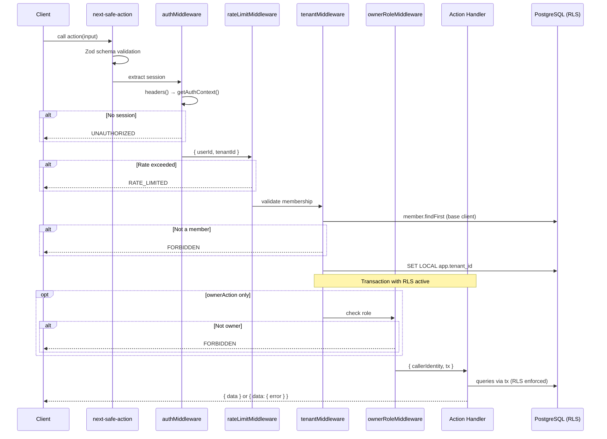

# Server Actions

Mandatory middleware chain enforcing authentication, tenant scoping, and RBAC on every Server Action. Built on `next-safe-action@8`.

## Overview

Every Server Action passes through a middleware chain that extracts auth context, enforces rate limits, validates tenant membership, and opens a RLS-scoped database transaction. No action can bypass security checks.

## Quick Start

```typescript
'use server';
import { ownerAction } from '@/server/middleware/action-client';
import { z } from 'zod/v4';

// Read action
export const getTenantProfile = ownerAction
  .schema(z.object({}))
  .action(async ({ ctx }) => {
    const config = await ctx.tx.tenantConfig.findMany();
    return { config: config.map((c) => ({ key: c.key, value: c.value })) };
  });

// Write action — validate first, write second
export const updateTenantProfile = ownerAction
  .schema(z.object({ name: z.string().min(1) }))
  .action(async ({ ctx, parsedInput }) => {
    await ctx.tx.tenantConfig.upsert({
      where: { tenantId_key: { tenantId: ctx.callerIdentity.tenantId, key: 'company_name' } },
      update: { value: parsedInput.name },
      create: {
        tenantId: ctx.callerIdentity.tenantId,
        key: 'company_name',
        value: parsedInput.name,
        createdBy: ctx.callerIdentity.userId,
        source: 'user',
      },
    });
    return { success: true };
  });
```

## Middleware Chain



## Action Types

| Operation | Chain | Accountant? | Example |
|-----------|-------|-------------|---------|
| Public (no auth) | `publicAction` | N/A | login, register |
| Read (any role) | `authedAction` | Yes (read) | get journal entries |
| Write (any) | `ownerAction` | No | create entry, upload doc |
| Read settings (owner) | `ownerAction` | No | `getTenantProfile` |
| Write settings | `ownerAction` | No | `updateTenantProfile` |
| List members | `ownerAction` | No | `listTenantMembers` |

## Error Handling Contract

Errors follow two paths:

1. **Handler business errors** → `result.data.error` (AppError object)
2. **Middleware/framework errors** → `result.serverError` (AppError object via `handleServerError`)
3. **Validation errors** → `result.validationErrors` (Zod errors)

`AppError.message` is developer-facing (for logs). The client maps `AppError.code` to user-friendly localized text.

```
Middleware throws ActionError → handleServerError → serverError (AppError)
Handler returns { error }    → data.error (AppError)
Unhandled crash              → handleServerError → INTERNAL_ERROR
Zod validation fails         → validationErrors
```

## Client Consumption Pattern

```typescript
const result = await updateTenantProfile({ name: '...' });
if (result?.serverError) {
  // Middleware error — map serverError.code to user message
}
if (result?.data?.error) {
  // Handler business error — map error.code to user message
}
if (result?.validationErrors) {
  // Zod validation errors
}
// Success
const data = result?.data;
```

## Testing Actions

Actions are plain async functions — call them directly in Vitest:

```typescript
import { ownerAction } from '@/server/middleware/action-client';

// Mock next/headers
vi.mock('next/headers', () => ({
  headers: vi.fn(async () => mockHeaders),
}));

// Create test action
const testAction = ownerAction.schema(z.object({})).action(async ({ ctx }) => {
  return { ok: true };
});

// Invoke directly
const result = await testAction({});
```

Use `createAuthenticatedContext()` from `src/kernel/db/test-fixtures.ts` for auth setup in tests.

## Rules & Constraints

1. **`'use server'` directive is mandatory** at the top of every action file
2. **Never use base `prisma` client in handlers** — always use `ctx.tx`
3. **Never call other Server Actions from a Server Action** — services call services
4. **Validate first, write second** — never return AppError after a DB write
5. **Return plain objects only** — never return raw Prisma models with `Decimal` fields
6. **Never import `createSafeActionClient` directly** — use `publicAction`, `authedAction`, or `ownerAction`
7. **`publicAction` must never perform database mutations**
8. **Side effects after transaction** — external calls after commit, not inside handler

## Design Decisions

- **Why next-safe-action:** Type-safe Server Action framework with middleware chain, Zod schema validation, and proper error handling. `.use()` chains clone (don't mutate), enabling safe composition.
- **Why in-memory rate limiting:** Single-process app with 2-3 users. No Redis dependency needed. Resets on restart (acceptable). The limit is 300 actions per user per minute — reads count too (a filter popup, a side panel, an autosave each take one), so 60 throttled an active owner and the e2e suite's two workers on one user (`Too many requests` surfaced as the invoices flow stalling on `main`, 2026-10-20).
- **Why this chain order (auth → rate limit → tenant):** Rate limiting before tenant avoids holding a DB transaction for rejected requests. Auth must come first to identify the user for rate limiting.
- **Why middleware-managed transactions:** `tenantMiddleware` wraps `next()` inside `withTenantTransaction`, making it impossible to forget RLS. Every handler automatically runs inside a tenant-scoped transaction.
- **Why ActionError throws:** `next-safe-action` discards middleware return values. Throwing allows `handleServerError` to convert business errors to structured AppError responses.

For how RLS is activated at runtime via this middleware chain, see [[prisma-rls-setup]].
For auth context extraction, see [[auth-setup]].
