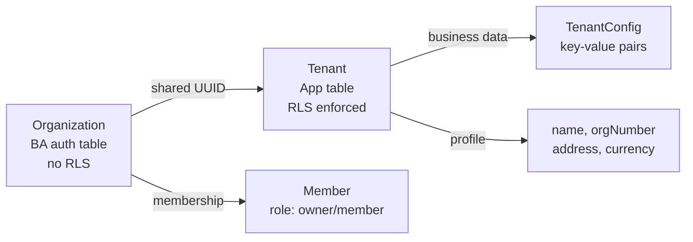

# Tenant Management

Tenant profile configuration, tenant switching, and the dual-model pattern for organization/tenant data.

## Tenant ↔ Organization Mapping

AF uses a dual-model pattern where Better Auth manages authentication and membership, while the app manages business data:



- **Organization** (auth table, no RLS) — source of truth for auth data (membership, roles, sessions)
- **Tenant** (app table, with RLS) — source of truth for business data (name, address, currency)
- **Shared UUID:** `Organization.id == Tenant.id == tenantId` on all app models
- **`afterCreateOrganization` hook** keeps them in sync at creation time
- **`updateTenantProfile` service** syncs name changes to both models

## Setup Flow

Run the seed to create development data:

```bash
npx prisma db seed
```

This creates:
- **Owner:** `owner@dev.test` / `password123`
- **Accountant:** `accountant@dev.test` / `password123`
- **Organization:** "Dev AB" (slug: `dev-ab`)
- **Tenant:** auto-created by `afterCreateOrganization` hook
- **TenantConfig:** company profile entries

The seed is idempotent — safe to run multiple times.

## Settings Architecture

```
Page (server component) → fetches data server-side
  └─ Form (client component) → auto-saves on blur
       └─ Server Action (ownerAction) → thin wrapper
            └─ Service (framework-agnostic) → business logic
                 └─ Prisma tx (RLS-scoped) → database
```

- **Service:** `src/modules/settings/settings.ts` — MUST NOT import from `next/*`
- **Actions:** `src/modules/settings/settings.actions.ts` — `ownerAction` chain, Zod validation
- **Page:** `src/app/(app)/settings/company/page.tsx` — server component renders client form

## Tenant Switching

When a user switches tenants:

1. `authClient.organization.setActive({ organizationId })` — updates session
2. `queryClient.clear()` — clears all cached data
3. `router.refresh()` — re-renders server components with new tenant context
4. Sidebar navigation disabled during switch to prevent race conditions

## Name Sync

Updating company name syncs both models:
- `Tenant.name` updated via RLS-scoped transaction
- `Organization.name` updated via base prisma client (auth tables have no RLS)

The `TenantSwitcher` component reads from the Organization list (via Better Auth client hooks), which stays in sync.

## Contact line (2026-10-20)

`tenants.email`, `website`, `phone` (migration `20261021000000_add_print_identity`) — Company profile fields printed on invoices: the email under the address, `name • email • website` in the footer ([[invoices]]).
